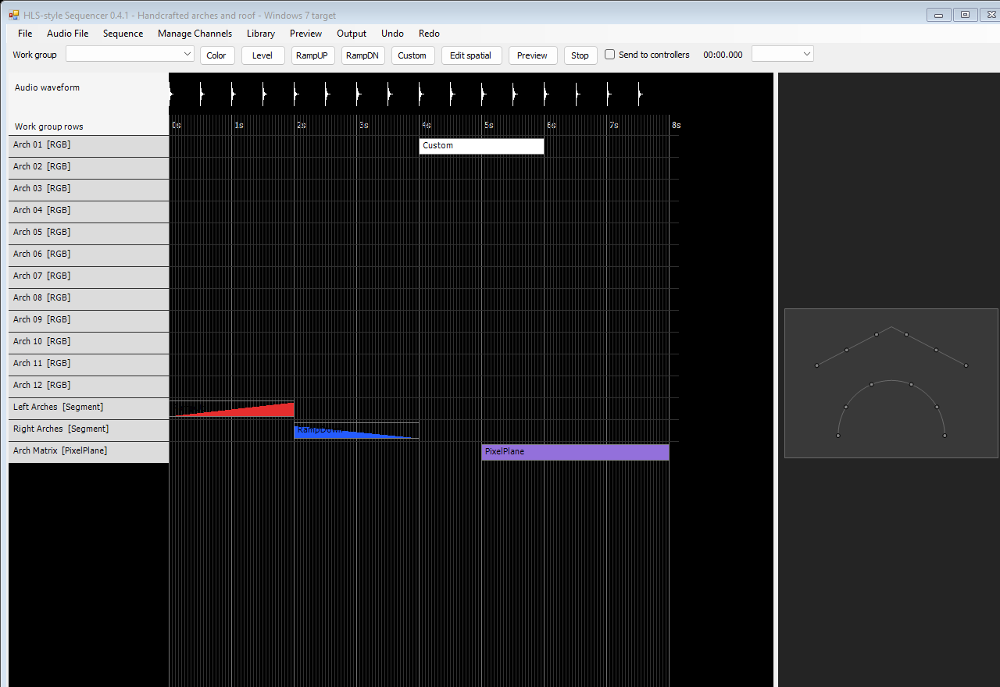

# HLS-style Sequencer

A handcrafted lighting sequencer inspired by Hinkle’s Lighting Sequencer (HLS), implemented in native C# 4 / Windows Forms with a Windows 7 target. This is an independent recreation, with its own project formats.

## Download and run on Windows 7

**[Download HLS-Sequencer.exe](https://github.com/goldpattyriley/hls-style-sequencer/releases/download/v0.4.1-testing/HLS-Sequencer.exe)**

Double-click **HLS-Sequencer.exe**. No ZIP extraction, `.exe.config`, adjacent audio or project files are needed. It opens with an editable demonstration sequence ready to explore.

The app contains its examples and creates a writable copy automatically under `%LOCALAPPDATA%\HlsStyleSequencer\Examples\0.4.1`. Relaunching preserves edited examples. Use **File > Open included example** to find the supplied projects.

Windows 7 x86/x64 needs **full .NET Framework 4.0** or a compatible installed later 4.x runtime. If Windows asks for .NET, use [Microsoft's .NET Framework 4 installer](https://www.microsoft.com/en-us/download/details.aspx?id=17718). No browser runtime, Python, Node or Electron is required.

[Release notes / optional ZIP](https://github.com/goldpattyriley/hls-style-sequencer/releases/tag/v0.4.1-testing) | [Testing steps](TESTING.md)

The executable targets Windows 7; actual execution on a Windows 7 machine and real controller hardware remain unverified. This is a testing release of an independent recreation, not every feature of original HLS.



## Implemented

- Raw channel management; overlapping ordered work groups; Segments and sparse PixelPlanes.
- Direct timeline editing, precise timing, Level/Ramp custom recipes, editable independent placements and reusable effect libraries.
- Photo-backed preview drawing, lines/arches/matrices/polylines, forward/reverse pixel assignments, shared Preview Control Files and explicit Compile/Identify workflow.
- E1.31/sACN and Renard controller setup, a physical-slot preparation report, recording tests and explicitly armed physical output.
- Audio-clock preview, background output worker, blackout/termination handling, FSEQ export, compiled-data freshness checks, undo and project recovery.
- Streamed project/library XML without the former arbitrary 16 MB size limit.

Output testing starts in **recording/dry-run mode**. Physical output requires explicitly arming and starting a session. Native automated network checks use an owned `127.0.0.1` receiver only. Data frame intervals are not measured physical-controller rates.

## Validation and limits

Version 0.4.1 passed **228 checks**, including isolated single-executable startup and all prior coverage, including prior channel/effect/library regressions, real project/library files above 16 MB, preview mapping and geometry, packet vectors, loopback output, stop/blackout recovery and compiled-file rollback. See [validation log](outputs/windows7/validation.txt), [build metadata](outputs/windows7/validation.json) and [package checks](outputs/windows7/package-validation.txt).

Original HLS `.hls`/`.hlsIdata`/library formats are unsupported. Our files use `.hlsr`, `.hlsrlib`, `.hlsrpreview` and `.hlsrshow`. Exact final-version HLS UI parity, original random algorithms, optical/audio synchronization, controller drivers, additional protocols and scheduled playlists remain future or unverified work. HLS and competitor code/graphics are not bundled.

## Build from source

Source and the existing build script live in [`outputs/windows7`](outputs/windows7). Use the Windows Framework C# compiler and the **full .NET 4.0 reference assemblies**, not a modern runtime or Client Profile.

```powershell
cd outputs/windows7
powershell -ExecutionPolicy Bypass -File build.ps1 -ReferenceDirectory "C:\path\to\full-net40-references"
```

The official reference pack is [Microsoft.NETFramework.ReferenceAssemblies.net40 1.0.3](https://www.nuget.org/packages/Microsoft.NETFramework.ReferenceAssemblies.net40/1.0.3); its full references are under `build/.NETFramework/v4.0`. Build references are not bundled runtime dependencies. The script embeds the example assets and produces one `HLS-Sequencer.exe`; no configuration file is generated.

Run the finite native checks without opening visible windows or an audio device:

```powershell
.\HLS-Sequencer.exe --self-test checks
```

Allow roughly 60 MB for test fixtures. Report problems through [Issues](https://github.com/goldpattyriley/hls-style-sequencer/issues/new/choose), including Windows/.NET version, reproduction steps, project version and recording versus physical output.
